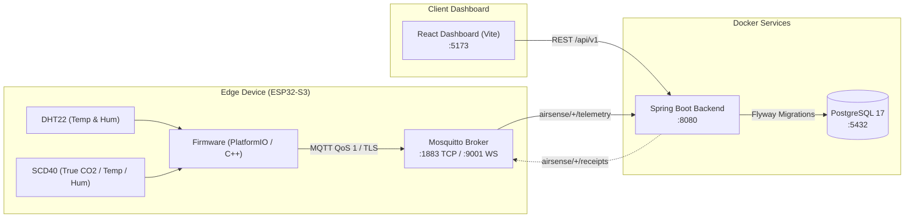

# AirSense IoT Application Project

An end-to-end, enterprise-grade IoT air quality monitoring system designed for real-time telemetry streaming, strict schema enforcement, and responsive data visualization.

---

## Table of Contents

- [Overview & Objectives](#overview--objectives)
- [System Architecture](#system-architecture)
- [Project Structure](#project-structure)
- [Hardware & Sensors](#hardware--sensors)
- [MQTT Topics & Data Contracts](#mqtt-topics--data-contracts)
- [Prerequisites](#prerequisites)
- [Quick Start](#quick-start)
- [Manual Step-by-Step Setup](#manual-step-by-step-setup)
  - [1. Infrastructure & Backend (Docker Compose)](#1-infrastructure--backend-docker-compose)
  - [2. Device Provisioning](#2-device-provisioning)
  - [3. Frontend Dashboard](#3-frontend-dashboard)
  - [4. ESP32-S3 Firmware](#4-esp32-s3-firmware)
- [Configuration & Runtime Serial CLI](#configuration--runtime-serial-cli)
- [Testing & Verification](#testing--verification)
- [Troubleshooting](#troubleshooting)

---

## Overview & Objectives

The primary objective of **AirSense** is to deliver a reliable, verifiable indoor air quality monitoring pipeline from low-level physical sensors to a browser-based dashboard.

### Key Objectives
1. **Accurate Environmental Sensing**: Continuous acquisition of Temperature and Humidity (DHT22) and True CO2 concentrations (Sensirion SCD40 NDIR sensor).
2. **Strict Contract & Data Integrity**: End-to-end schema validation using JSON Schema (Draft 2020-12) and OpenAPI 3.1. Telemetry records enforce immutable acquisition timestamps, boot identifiers, monotonically increasing sequences, and deduplication receipts.
3. **Resilient Edge Device Firmware**: Modular ESP32-S3 C++ firmware featuring WiFiMulti failover, automatic MQTT reconnection, flash-backed (NVS) runtime configuration, and Wi-Fi TX power management to prevent USB brownout resets.
4. **Interactive Dashboard**: Responsive React + Recharts frontend providing real-time telemetry polling, historical trending (up to 31 days with cursor pagination), sensor health metrics, and customizable threshold alert levels.

---

## System Architecture



### Component Details
- **Firmware (`/firmware`)**: C++ / Arduino framework running on ESP32-S3. Handles sensor acquisition, I2C/GPIO communication, WiFiMulti connection management, and MQTT telemetry publishing.
- **Contracts (`/contracts`)**: Single source of truth containing JSON Schema specifications for MQTT payloads and OpenAPI 3.1 definitions for the REST API.
- **Backend (`/backend`)**: Java 21 / Spring Boot 3.5.7 service consuming MQTT messages, enforcing contract semantics, managing PostgreSQL persistence, and exposing REST endpoints for analytics and configuration.
- **Frontend (`/frontend`)**: React 18, Vite, and Recharts single-page application for real-time monitoring and administrative configuration.
- **Mosquitto (`/mosquitto`)**: Eclipse Mosquitto 2.x message broker configured for both local TCP (1883) and WebSockets (9001).

---

## Project Structure

```text
├── backend/               # Spring Boot 3 + Java 21 application
│   ├── deploy/            # Deployment configurations & Mosquitto specs
│   ├── provision/         # Database init and simulator provisioning SQL scripts
│   ├── src/               # Application source code and unit/integration tests
│   ├── pom.xml            # Maven build configuration
│   └── Dockerfile         # Multi-stage container build
├── contracts/             # Shared contracts & API specifications
│   ├── fixtures/          # Valid and invalid JSON test fixtures
│   ├── schemas/           # JSON Schemas (telemetry, state, metadata, receipts)
│   ├── openapi.json       # OpenAPI 3.1 REST API specification
│   └── package.json       # Contract verification scripts
├── docs/                  # Project documentation & topic references
├── firmware/              # ESP32-S3 PlatformIO firmware
│   ├── include/           # Modular headers (config, connectivity, scd40, logger)
│   ├── src/               # Firmware source (main, connectivity, device_config, scd40)
│   └── platformio.ini     # PlatformIO environment, board, and library definitions
├── frontend/              # React 18 + Vite dashboard
│   ├── src/               # UI components, API client, charts, state management
│   ├── package.json       # Frontend dependencies and scripts
│   └── vite.config.js     # Dev server proxy configuration
├── mosquitto/             # MQTT broker configuration and persistent storage
│   └── config/mosquitto.conf
├── docker-compose.yml     # Compose manifest for Broker, PostgreSQL, and Backend
├── start-web.sh           # Automated boot script for local development
└── README.md              # Project documentation
```

---

## Hardware & Sensors

| Hardware Component | Interface | Default Pins / Connection | Description |
| :--- | :--- | :--- | :--- |
| **ESP32-S3 DevKit** | USB-C / UART | GPIO 19/20 (USB), GPIO 43/44 (UART) | Main microcontroller running firmware |
| **DHT22 (AM2302)** | Single-Bus (Digital) | `GPIO 4` | Ambient temperature and humidity sensor |
| **Sensirion SCD40** | I2C (Address `0x62`)| `SDA: GPIO 8`, `SCL: GPIO 9` | Photoacoustic NDIR CO2 sensor (400 - 2000+ ppm) |
| **Power Supply** | USB (5V) | Min 5V / 1A | Recommended: high-quality short USB cable |

---

## MQTT Topics & Data Contracts

All telemetry follows the contract specifications in `contracts/schemas/`:

| Topic | Direction | QoS | Description |
| :--- | :---: | :---: | :--- |
| `airsense/{deviceId}/telemetry` | Edge $\rightarrow$ Backend | 1 | Periodic sensor data package (JSON payload) |
| `airsense/{deviceId}/state` | Edge $\rightarrow$ Backend | 1 | Node online status, boot ID, and telemetry queue depth |
| `airsense/{deviceId}/metadata` | Edge $\rightarrow$ Backend | 1 | Hardware rev, firmware version, sensor profile info |
| `airsense/{deviceId}/receipts` | Backend $\rightarrow$ Edge | 1 | Ingestion receipt (`COMMITTED`, `REPLAY`, `ID_CONFLICT`) |

### Example Telemetry Payload
```json
{
  "schemaVersion": 1,
  "deviceId": "AIRSENSE-001",
  "messageId": "AIRSENSE-001:b7f3a901:100000",
  "bootId": "b7f3a901",
  "sequence": 100000,
  "uptimeMs": 45200,
  "timeQuality": "SYNCED",
  "measuredAt": "2026-11-08T06:30:00Z",
  "reportIntervalSec": 10,
  "values": {
    "temperatureC": 26.4,
    "humidityPct": 58.2,
    "gasRelative": null,
    "dustEstimateUgM3": null
  },
  "raw": {
    "gasAdcCounts": null,
    "gasAdcMv": null,
    "dustAdcCounts": null,
    "dustAdcMv": null
  },
  "quality": {
    "sht30": "VALID",
    "mq135": "UNAVAILABLE",
    "dust": "UNAVAILABLE"
  },
  "calibration": {
    "gasId": null,
    "dustId": null
  }
}
```

---

## Prerequisites

Before starting, ensure the following tools are installed:
- **Docker Engine & Docker Compose** (v24+)
- **Node.js** (v20.x or v22.x LTS) & **npm**
- **PlatformIO Core or VS Code PlatformIO IDE** (for flashing ESP32-S3 firmware)
- *(Optional)* **Java 21 JDK** & **Maven** (only if building the backend locally outside Docker)

---

## Quick Start

The fastest way to launch the entire stack (Mosquitto, PostgreSQL, Backend, and Frontend) is using the included automation script:

```bash
chmod +x start-web.sh
./start-web.sh
```

### What this script does:
1. Builds and launches the Mosquitto, PostgreSQL, and Spring Boot containers in background mode.
2. Waits for PostgreSQL and Flyway schema migrations to complete.
3. Automatically provisions test device `AIRSENSE-001` (matching `firmware/include/config.h`).
4. Installs frontend npm packages (if needed) and launches the Vite dev server at **`http://localhost:5173`**.

---

## Manual Step-by-Step Setup

If you prefer to run each component independently:

### 1. Infrastructure & Backend (Docker Compose)
From the repository root:
```bash
docker compose up -d --build
```
Verify all 3 containers are healthy:
```bash
docker compose ps
```
Services exposed:
- **Mosquitto MQTT**: `localhost:1883` (TCP), `localhost:9001` (WebSockets)
- **PostgreSQL 17**: `localhost:5432` (User/DB: `airsense`, Pass: `airsense_local_pass`)
- **Backend API**: `localhost:8080`

### 2. Device Provisioning
Register device `AIRSENSE-001` in the database:
```bash
docker compose exec -T database psql -U airsense -d airsense -v ON_ERROR_STOP=1 < backend/provision/simulator.sql
docker compose restart backend
```

### 3. Frontend Dashboard
Navigate to the `frontend` directory:
```bash
cd frontend
npm ci
npm run dev
```
Open **`http://localhost:5173`** in your browser.
- **Live API mode**: Connects to the local backend at `http://localhost:8080/api`.
- **Fixture preview mode**: Toggle in the UI header to test without running a backend.

### 4. ESP32-S3 Firmware
1. Open the `/firmware` directory in VS Code with PlatformIO, or open a terminal:
   ```bash
   cd firmware
   ```
2. Adjust your Wi-Fi SSID and MQTT broker host in `firmware/include/config.h`:
   ```cpp
   #define DEFAULT_WIFI_SSID   "Your_WiFi_SSID"
   #define DEFAULT_WIFI_PASS   "Your_WiFi_Password"
   #define DEFAULT_MQTT_HOST   "192.168.1.94" // IP of machine hosting Mosquitto
   ```
3. Build and upload firmware to the ESP32-S3:
   ```bash
   pio run -t upload
   ```
4. Open the Serial Monitor to observe boot logs:
   ```bash
   pio device monitor -b 115200
   ```

---

## Configuration & Runtime Serial CLI

The firmware supports real-time configuration directly through the Serial Monitor at `115200 baud` without having to reflash the chip:

| Serial Command | Syntax | Description |
| :--- | :--- | :--- |
| `status` | `status` | Display current device ID, Wi-Fi IP, and MQTT connection state |
| `wifi` | `wifi <SSID> <PASSWORD>` | Update Wi-Fi credentials and persist to Flash NVS |
| `mqtt` | `mqtt <HOST> [PORT] [USER] [PASS]` | Update MQTT broker details and reconnect immediately |
| `reset` | `reset` | Clear NVS settings and restore defaults from `config.h` |
| `help` | `help` or `?` | Print available command syntax |

---

## Testing & Verification

### 1. Monitor Live MQTT Messages
To verify sensor data is reaching the broker:
```bash
docker exec -it iot-mosquitto mosquitto_sub -t "airsense/#" -v
```

### 2. Validate Contracts & Schemas
Ensure all schemas and mock fixtures adhere to draft 2020-12 specifications:
```bash
cd contracts
npm ci --ignore-scripts
npm test
```

### 3. Run Backend Test Suite
Run unit tests for ingestion, replay handling, and rule boundaries:
```bash
mvn -f backend/pom.xml test
```

### 4. Run Frontend Tests
```bash
cd frontend
npm test
```

---

## Troubleshooting

### 1. ESP32-S3 Brownout Loop (`Brownout detector was triggered`)
- **Cause**: Current spikes when the ESP32 Wi-Fi radio transmits under weak USB power.
- **Solution 1**: Ensure `WIFI_TX_POWER` is defined in `firmware/include/config.h`:
  ```cpp
  #define WIFI_TX_POWER WIFI_POWER_8_5dBm
  ```
- **Solution 2**: Use a shorter, higher-gauge USB cable or connect via a powered USB hub.
- **Solution 3**: Add an electrolytic capacitor (470 µF - 1000 µF) between the `3V3` and `GND` pins.

### 2. MQTT Broker Refusing Connections
- Verify `mosquitto/config/mosquitto.conf` has `allow_anonymous true` and listens on `0.0.0.0:1883`.
- Check broker container logs:
  ```bash
  docker logs iot-mosquitto --tail 50
  ```

### 3. Telemetry Discarded by Backend (`ID_CONFLICT` or missing device)
- Ensure the device ID and boot ID match `backend/provision/simulator.sql` (`AIRSENSE-001` and `b7f3a901`).
- Check backend logs:
  ```bash
  docker logs iot-backend --tail 50
  ```

---

## License

This project is licensed under the MIT License. See [LICENSE](LICENSE) for details if applicable.
