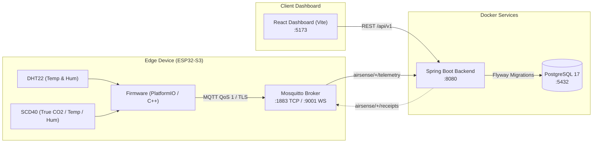

# AirSense IoT Application Project

An end-to-end, enterprise-grade IoT air quality monitoring system designed for real-time telemetry streaming, strict schema enforcement, and responsive data visualization.

---

## Table of Contents

- [Overview & Objectives](#overview--objectives)
- [System Architecture](#system-architecture)
- [Project Structure](#project-structure)
- [Hardware & Sensors](#hardware--sensors)
- [MQTT Topics & Data Contracts](#mqtt-topics--data-contracts)
- [Prerequisites](#prerequisites)
- [Quick Start](#quick-start)
- [Manual Step-by-Step Setup](#manual-step-by-step-setup)
  - [1. Infrastructure & Backend (Docker Compose)](#1-infrastructure--backend-docker-compose)
  - [2. Device Provisioning](#2-device-provisioning)
  - [3. Frontend Dashboard](#3-frontend-dashboard)
  - [4. ESP32-S3 Firmware & MQTT Setup](#4-esp32-s3-firmware--mqtt-setup)
- [MQTT Connection Guide (Local Mosquitto vs. Cloud EMQX)](#mqtt-connection-guide-local-mosquitto-vs-cloud-emqx)
- [Configuration & Runtime Serial CLI](#configuration--runtime-serial-cli)
- [Testing & Verification](#testing--verification)
- [Troubleshooting](#troubleshooting)

---

## Overview & Objectives

The primary objective of **AirSense** is to deliver a reliable, verifiable indoor air quality monitoring pipeline from low-level physical sensors to a browser-based dashboard.

### Key Objectives
1. **Accurate Environmental Sensing**: Continuous acquisition of Temperature and Humidity (DHT22) and True CO2 concentrations (Sensirion SCD40 NDIR sensor).
2. **Strict Contract & Data Integrity**: End-to-end schema validation using JSON Schema (Draft 2020-12) and OpenAPI 3.1. Telemetry records enforce immutable acquisition timestamps, boot identifiers, monotonically increasing sequences, and deduplication receipts.
3. **Resilient Edge Device Firmware**: Modular ESP32-S3 C++ firmware featuring WiFiMulti failover, automatic MQTT reconnection, flash-backed (NVS) runtime configuration, and Wi-Fi TX power management to prevent USB brownout resets.
4. **Interactive Dashboard**: Responsive React + Recharts frontend providing real-time telemetry polling, historical trending (up to 31 days with cursor pagination), sensor health metrics, and customizable threshold alert levels.

---

## System Architecture



### Component Details
- **Firmware (`/firmware`)**: C++ / Arduino framework running on ESP32-S3. Handles sensor acquisition, I2C/GPIO communication, WiFiMulti connection management, and MQTT telemetry publishing.
- **Contracts (`/contracts`)**: Single source of truth containing JSON Schema specifications for MQTT payloads and OpenAPI 3.1 definitions for the REST API.
- **Backend (`/backend`)**: Java 21 / Spring Boot 3.5.7 service consuming MQTT messages, enforcing contract semantics, managing PostgreSQL persistence, and exposing REST endpoints for analytics and configuration.
- **Frontend (`/frontend`)**: React 18, Vite, and Recharts single-page application for real-time monitoring and administrative configuration.
- **Mosquitto (`/mosquitto`)**: Eclipse Mosquitto 2.x message broker configured for both local TCP (1883) and WebSockets (9001).

---

## Project Structure

```text
├── backend/               # Spring Boot 3.5.7 + Java 21 application
│   ├── deploy/            # Deployment configurations & Mosquitto specs
│   ├── provision/         # Database init and simulator provisioning SQL scripts
│   ├── src/               # Feature packages (auth, ingestion, monitoring, threshold, operations, common)
│   ├── pom.xml            # Maven build & Spotless configuration
│   └── Dockerfile         # Multi-stage container build
├── contracts/             # Shared contracts & API specifications
│   ├── fixtures/          # Valid and invalid JSON test fixtures
│   ├── schemas/           # JSON Schemas (telemetry, state, metadata, receipts, command, adc-profile)
│   ├── tools/             # Schema & semantic validators (validate.mjs, check.mjs)
│   ├── openapi.json       # OpenAPI 3.1 REST API specification
│   └── package.json       # Contract verification scripts
├── docs/                  # Project documentation & topic references
├── firmware/              # ESP32-S3 PlatformIO firmware
│   ├── include/           # Domain headers
│   │   ├── config/        # pins.h, device_constants.h, mqtt_ca.h, secrets.example.h, secrets.h
│   │   ├── connectivity/  # Wi-Fi (WiFiMulti) + MQTT (Plain TCP 1883 / TLS 8883)
│   │   ├── sensors/       # EnvironmentSensor facade, SCD40 I2C driver, sensor_types.h
│   │   ├── system/        # DeviceConfig (NVS), dual Logger, SerialCommands CLI
│   │   ├── telemetry/     # Contract-compliant JSON TelemetryBuilder
│   │   └── config.h       # Umbrella configuration header
│   ├── src/               # Domain implementations and main.cpp entry point
│   ├── test/              # Host C++ unit tests (test_firmware.cpp, mocks/, run_tests.sh)
│   ├── README.md          # Firmware architecture, configuration, and testing guide
│   └── platformio.ini     # PlatformIO environment, board, and library definitions
├── frontend/              # React 18 + Vite dashboard
│   ├── src/               # Feature modules (app/, features/, shared/, fixtures/)
│   ├── tests/             # Node model unit tests
│   ├── package.json       # Frontend dependencies and scripts
│   └── vite.config.js     # Dev server proxy configuration
├── mosquitto/             # MQTT broker configuration and persistent storage
│   └── config/mosquitto.conf
├── AGENTS.md              # Project coding conventions and architectural rules
├── docker-compose.yml     # Compose manifest for Broker, PostgreSQL, and Backend
├── start-web.sh           # Automated boot script for local development
└── README.md              # Project documentation
```

---

## Hardware & Sensors

| Hardware Component | Interface | Default Pins / Connection | Description |
| :--- | :--- | :--- | :--- |
| **ESP32-S3 DevKit** | USB-C / UART | GPIO 19/20 (USB), GPIO 43/44 (UART) | Main microcontroller running firmware |
| **DHT22 (AM2302)** | Single-Bus (Digital) | `GPIO 4` | Ambient temperature and humidity sensor |
| **Sensirion SCD40** | I2C (Address `0x62`)| `SDA: GPIO 8`, `SCL: GPIO 9` | Photoacoustic NDIR CO2 sensor (400 - 2000+ ppm) |
| **Power Supply** | USB (5V) | Min 5V / 1A | Recommended: high-quality short USB cable |

---

## MQTT Topics & Data Contracts

All telemetry follows the contract specifications in `contracts/schemas/`:

| Topic | Direction | QoS | Description |
| :--- | :---: | :---: | :--- |
| `airsense/{deviceId}/telemetry` | Edge $\rightarrow$ Backend | 1 | Periodic sensor data package (JSON payload) |
| `airsense/{deviceId}/state` | Edge $\rightarrow$ Backend | 1 | Node online status, boot ID, and telemetry queue depth |
| `airsense/{deviceId}/metadata` | Edge $\rightarrow$ Backend | 1 | Hardware rev, firmware version, sensor profile info |
| `airsense/{deviceId}/receipts` | Backend $\rightarrow$ Edge | 1 | Ingestion receipt (`COMMITTED`, `REPLAY`, `ID_CONFLICT`) |

### Example Telemetry Payload
```json
{
  "schemaVersion": 1,
  "deviceId": "AIRSENSE-001",
  "messageId": "AIRSENSE-001:b7f3a901:100000",
  "bootId": "b7f3a901",
  "sequence": 100000,
  "uptimeMs": 45200,
  "timeQuality": "SYNCED",
  "measuredAt": "2026-11-08T06:30:00Z",
  "reportIntervalSec": 30,
  "values": {
    "temperatureC": 26.4,
    "humidityPct": 58.2,
    "gasRelative": null,
    "dustEstimateUgM3": null
  },
  "raw": {
    "gasAdcCounts": null,
    "gasAdcMv": null,
    "dustAdcCounts": null,
    "dustAdcMv": null
  },
  "quality": {
    "sht30": "VALID",
    "mq135": "UNAVAILABLE",
    "dust": "UNAVAILABLE"
  },
  "calibration": {
    "gasId": null,
    "dustId": null
  }
}
```

---

## Prerequisites

Before starting, ensure the following tools are installed:
- **Docker Engine & Docker Compose** (v24+)
- **Node.js** (v20.x or v22.x LTS) & **npm**
- **PlatformIO Core or VS Code PlatformIO IDE** (for flashing ESP32-S3 firmware)
- *(Optional)* **Java 21 JDK** & **Maven** (only if building the backend locally outside Docker)

---

## Quick Start

The fastest way to launch the entire stack (Mosquitto, PostgreSQL, Backend, and Frontend) is using the included automation script:

```bash
chmod +x start-web.sh
./start-web.sh
```

### What this script does:
1. Builds and launches the Mosquitto, PostgreSQL, and Spring Boot containers in background mode.
2. Waits for PostgreSQL and Flyway schema migrations to complete.
3. Automatically provisions test device `AIRSENSE-001` (matching `firmware/include/config/device_constants.h`).
4. Installs frontend npm packages (if needed) and launches the Vite dev server at **`http://localhost:5173`**.

---

## Manual Step-by-Step Setup

If you prefer to run each component independently:

### 1. Infrastructure & Backend (Docker Compose)
From the repository root:
```bash
docker compose up -d --build
```
Verify all 3 containers are healthy:
```bash
docker compose ps
```
Services exposed:
- **Mosquitto MQTT**: `localhost:1883` (TCP), `localhost:9001` (WebSockets)
- **PostgreSQL 17**: `localhost:5432` (User/DB: `airsense`, Pass: `airsense_local_pass`)
- **Backend API**: `localhost:8080`

### 2. Device Provisioning
Register device `AIRSENSE-001` in the database:
```bash
docker compose exec -T database psql -U airsense -d airsense -v ON_ERROR_STOP=1 < backend/provision/simulator.sql
docker compose restart backend
```

### 3. Frontend Dashboard
Navigate to the `frontend` directory:
```bash
cd frontend
npm ci
npm run dev
```
Open **`http://localhost:5173`** in your browser.
- **Live API mode**: Connects to the local backend at `http://localhost:8080/api`.
- **Fixture preview mode**: Toggle in the UI header to test without running a backend.

### 4. ESP32-S3 Firmware & MQTT Setup

1. Open the `/firmware` directory:
   ```bash
   cd firmware
   ```

2. Copy `include/config/secrets.example.h` to `include/config/secrets.h`:
   ```bash
   cp include/config/secrets.example.h include/config/secrets.h
   ```

3. Choose your MQTT Broker target in `secrets.h`:
   - **Option A: Local Mosquitto Broker (TCP 1883)**:
     ```cpp
     #define DEFAULT_WIFI_SSID   "Your_WiFi_SSID"
     #define DEFAULT_WIFI_PASS   "Your_WiFi_Password"
     #define DEFAULT_MQTT_HOST   "192.168.1.94" // Host machine IP running Docker Mosquitto
     #define DEFAULT_MQTT_PORT   1883
     #define DEFAULT_MQTT_USER   ""
     #define DEFAULT_MQTT_PASS   ""
     ```
   - **Option B: Cloud Broker (EMQX Cloud TLS 8883)**:
     ```cpp
     #define DEFAULT_WIFI_SSID   "Your_WiFi_SSID"
     #define DEFAULT_WIFI_PASS   "Your_WiFi_Password"
     #define DEFAULT_MQTT_HOST   "xxxx.ala.asia-southeast1.emqxsl.com"
     #define DEFAULT_MQTT_PORT   8883
     #define DEFAULT_MQTT_USER   "your_emqx_username"
     #define DEFAULT_MQTT_PASS   "your_emqx_password"
     ```
     *(When configured with port `8883` or `8884`, the firmware automatically activates TLS using the bundled DigiCert Root CA in `firmware/include/config/mqtt_ca.h` and synchronizes time via NTP).*

4. **Build, Flash, and Monitor by Operating System**:

   #### 🐧 Linux:

   - **Serial Port Permissions & USB Bus Access**:
     When connecting the ESP32-S3 on Linux, the device typically registers as `/dev/ttyACM0` (native USB CDC) or `/dev/ttyUSB0` (UART bridge such as CH343/CP2102). If you encounter a `Permission denied` error, grant access:
     ```bash
     # Method 1: Add user to dialout group (Permanent, recommended):
     sudo usermod -aG dialout $USER
     # Activate group immediately (or log out and log back in):
     newgrp dialout

     # Method 2: Temporary direct bus permission:
     sudo chmod 666 /dev/ttyACM0
     # (or sudo chmod 666 /dev/ttyUSB0 for USB-UART chip)
     ```

   - **PlatformIO CLI Commands on Linux**:
     If PlatformIO was installed via the VS Code extension, the global `pio` command may not be in `$PATH`. Use the direct executable path:
     ```bash
     # Build and upload firmware:
     ~/.platformio/penv/bin/pio run -t upload

     # Open Serial Monitor (115200 baud):
     ~/.platformio/penv/bin/pio device monitor -b 115200

     # Or target a specific port if multiple devices are attached:
     ~/.platformio/penv/bin/pio run -t upload --upload-port /dev/ttyACM0
     ~/.platformio/penv/bin/pio device monitor -b 115200 -p /dev/ttyACM0
     ```
     *(Tip: Add `export PATH="$HOME/.platformio/penv/bin:$PATH"` to your `~/.bashrc` or `~/.zshrc` to use `pio` globally).*

   #### 🪟 Windows:

   - Open PlatformIO Core CLI terminal or PowerShell:
     ```powershell
     # Build and upload firmware:
     pio run -t upload

     # Open Serial Monitor (115200 baud):
     pio device monitor -b 115200
     ```
   - If `pio` is not recognized in the environment PATH:
     ```powershell
     # Use direct penv executable path:
     %USERPROFILE%\.platformio\penv\Scripts\pio.exe run -t upload
     %USERPROFILE%\.platformio\penv\Scripts\pio.exe device monitor -b 115200

     # Target a specific COM port if required (e.g., COM3):
     pio run -t upload --upload-port COM3
     pio device monitor -b 115200 -p COM3
     ```

---

## MQTT Connection Guide (Local Mosquitto vs. Cloud EMQX)

The architecture supports seamless switching between a local development broker and a managed cloud broker for both the backend service and edge firmware:

| Configuration / Feature | Local Mosquitto (Development) | Cloud Broker - EMQX Cloud (Production / Remote) |
| :--- | :--- | :--- |
| **Transport Protocol** | Plain TCP (`1883`) | TLS / SSL (`8883` or `8884`) |
| **Security** | Unencrypted / Anonymous | TLS Certificate + Username & Password |
| **Root CA** | Not required | Bundled DigiCert Global Root G2 in `mqtt_ca.h` |
| **NTP Synchronization** | Optional | Required (firmware synchronizes automatically via NTP pool) |

### 1. Backend Service Configuration (`docker-compose.yml`)

Edit the `environment` section for the `backend` service in `docker-compose.yml`:

- **Connecting to Local Mosquitto in Docker**:
  ```yaml
  MQTT_URI: tcp://mosquitto:1883
  MQTT_USERNAME: backend
  MQTT_PASSWORD: ${MQTT_PASSWORD:-airsense_mqtt_pass}
  MQTT_ENABLED: "true"
  ```

- **Connecting to EMQX Cloud (TLS)**:
  ```yaml
  MQTT_URI: ssl://<cluster-id>.ala.asia-southeast1.emqxsl.com:8883
  MQTT_USERNAME: <your_emqx_username>
  MQTT_PASSWORD: <your_emqx_password>
  MQTT_ENABLED: "true"
  ```
  > [!IMPORTANT]
  > When connecting to port `8883` on EMQX Cloud, **the `ssl://` URI prefix is mandatory**. Omitting the prefix or using `tcp://` causes Eclipse Paho to reject the connection configuration, resulting in a container crash loop and frontend proxy error `AggregateError [ECONNREFUSED]` on port 8080.

After updating the configuration, restart the backend container:
```bash
docker compose up -d backend
```

### 2. Edge Device Firmware Configuration (ESP32-S3)

Configure credentials before flashing in `firmware/include/config/secrets.h`, or modify them dynamically at runtime through the Serial CLI (detailed below).

---

## Configuration & Runtime Serial CLI

The firmware supports real-time Wi-Fi and MQTT reconfiguration directly through the Serial Monitor at `115200` baud without reflashing. All parameters persist across reboots in ESP32 Flash NVS:

| Serial Command | Syntax | Description |
| :--- | :--- | :--- |
| `status` | `status` | Display current device ID, Wi-Fi IP, and MQTT broker state |
| `wifi` | `wifi <SSID> <PASSWORD>` | Update Wi-Fi credentials and persist to Flash NVS |
| `mqtt` | `mqtt <HOST> [PORT] [USER] [PASS]` | Update MQTT broker details and reconnect immediately |
| `reset` | `reset` | Clear NVS settings and restore compile-time defaults from `secrets.h` |
| `help` | `help` or `?` | Print available command syntax |

### Interactive Serial CLI Examples:

- **Switch to Local Mosquitto**:
  ```text
  mqtt 192.168.1.94 1883
  ```
- **Switch to EMQX Cloud (TLS 8883)**:
  ```text
  mqtt xxxx.ala.asia-southeast1.emqxsl.com 8883 airsense MySecretPassword123
  ```
- **Inspect Connection Status**:
  ```text
  status
  ```

---

## Testing & Verification

### 1. Monitor Live MQTT Messages
To verify sensor data is reaching the broker:
- **Local Mosquitto**:
  ```bash
  docker exec -it iot-mosquitto mosquitto_sub -t "airsense/#" -v
  ```
- **EMQX Cloud**:
  Use the **WebSocket Client** inside the EMQX Cloud Console Dashboard or the [MQTTX](https://mqttx.app/) desktop client, connect, and subscribe to topic `airsense/#`.

### 2. Validate Contracts & Schemas
Ensure all schemas and mock fixtures adhere to draft 2020-12 specifications:
```bash
cd contracts
npm ci --ignore-scripts
npm test
```

### 3. Run Backend Test Suite
Run unit tests for ingestion, replay handling, and rule boundaries:
```bash
mvn -f backend/pom.xml test
```

### 4. Run Frontend Tests
```bash
cd frontend
npm test
```

### 5. Run Firmware Unit Tests & Contract Verification
Compile and run the host C++ unit tests for all firmware modules (`Logger`, `Scd40`, `EnvironmentSensor`, `DeviceConfig`, `Connectivity`, `SerialCommands`, `TelemetryBuilder`) and validate generated JSON payloads against `contracts/schemas/telemetry.schema.json`:
```bash
./firmware/test/run_tests.sh
```

---

## Troubleshooting

### 1. Linux Serial Port Permission Denied (`Permission denied: '/dev/ttyACM0'`)
- **Symptoms**: Running `pio device monitor` or `pio run -t upload` fails with `Could not open port /dev/ttyACM0: [Errno 13] Permission denied`.
- **Solution**:
  ```bash
  sudo usermod -aG dialout $USER
  newgrp dialout
  ```
  Or grant temporary bus access:
  ```bash
  sudo chmod 666 /dev/ttyACM0
  ```

### 2. Command Not Found (`pio: command not found`) on Linux / Windows
- **Cause**: PlatformIO installed through the VS Code extension runs in an isolated virtual environment not added to the default system `PATH`.
- **Solution**:
  - On **Linux**: Use `~/.platformio/penv/bin/pio` or add it to `~/.bashrc`:
    ```bash
    echo 'export PATH="$HOME/.platformio/penv/bin:$PATH"' >> ~/.bashrc
    source ~/.bashrc
    ```
  - On **Windows**: Use `%USERPROFILE%\.platformio\penv\Scripts\pio.exe` or open the terminal using the PlatformIO Core CLI button in the VS Code status bar.

### 3. Web Dashboard: `AggregateError [ECONNREFUSED]` or `500 Service Unavailable`
- **Cause**: The Vite frontend proxy cannot connect to port `8080` because the `iot-backend` container exited prematurely.
- **Diagnostic**:
  ```bash
  docker compose logs backend --tail 50
  ```
- **Solution**:
  - When using EMQX Cloud, verify `MQTT_URI` in `docker-compose.yml` **starts with `ssl://`** (e.g., `ssl://xxxx.emqxsl.com:8883`). If the prefix is missing or uses `tcp://`, the backend will crash on startup.
  - After correcting the URI, run: `docker compose up -d backend`.

### 4. ESP32-S3 Brownout Loop (`Brownout detector was triggered`)
- **Cause**: Current spikes when the ESP32 Wi-Fi radio transmits under weak USB power.
- **Solution 1**: Ensure `WIFI_TX_POWER` is defined in `firmware/include/config/device_constants.h`:
  ```cpp
  #define WIFI_TX_POWER WIFI_POWER_8_5dBm
  ```
- **Solution 2**: Use a shorter, higher-gauge USB cable or connect via a powered USB hub.
- **Solution 3**: Add an electrolytic capacitor (470 µF - 1000 µF) between the `3V3` and `GND` pins.

### 5. MQTT Broker Refusing Connections
- Verify `mosquitto/config/mosquitto.conf` has `allow_anonymous true` and listens on `0.0.0.0:1883`.
- Check broker container logs:
  ```bash
  docker logs iot-mosquitto --tail 50
  ```

### 6. Telemetry Discarded by Backend (`ID_CONFLICT` or missing device)
- Ensure the device ID and boot ID match `backend/provision/simulator.sql` (`AIRSENSE-001` and `b7f3a901`).
- Check backend logs:
  ```bash
  docker logs iot-backend --tail 50
  ```

---

## License

This project is licensed under the MIT License. See [LICENSE](LICENSE) for details if applicable.
